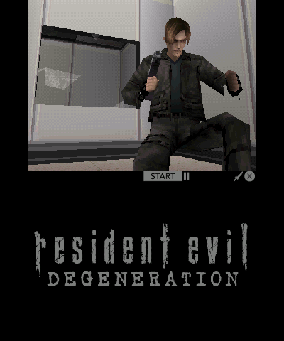
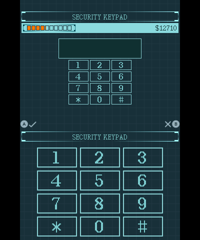
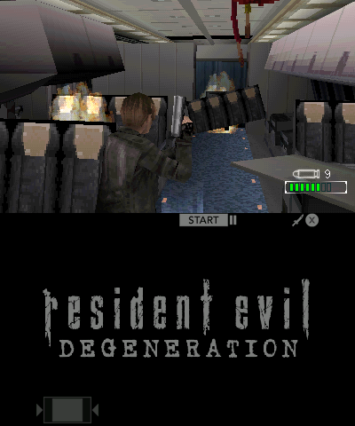

# Resident Evil Degeneration — New Nintendo 3DS

    

Based on the MGSM compatibility framework and the separate Need for Speed Undercover, Pandemonium and Project Gotham Racing ports.

This is a hybridisation of the N-Gage 2.0, BREW and iOS versions of Resident Evil Degeneration, using assets converted from the iOS and BREW versions to cover the gaps made by the N-Gage 2.0's XOR-masked bit manipulation.

It is likely to not be perfectly identical to either version, but the whole game is completable from start to finish without major issue.

## Installation

Requires a **New Nintendo 3DS / New 3DS XL / New 2DS XL** with the Homebrew Launcher. Merge the included `3ds` folder into the SD card root. Launch Resident Evil Degeneration. Preserve `3ds/res_degene/user` when updating: it contains your saves. No saves are included.

Releases requires your own matching N-Gage game package, BREW archive and iOS donor copy; see PREPARING_GAME_DATA.md. The GitHub source package contains compatibility source, artwork and restoration patches, with no complete game data files.

Consider using the automated extractor for preparing your game files:
https://github.com/littleHatter/Airplay-New3DS-Game-Data-Preparation-Tool

## Controls

| Input | Action |
| --- | --- |
| D-pad / Circle Pad | Move |
| A or R | Confirm / action / fire |
| Y | Reload |
| L | Use knife / zoom |
| X | Left softkey / aim / exit aim |
| B | Right softkey / back |
| Start | Pause (existing right softkey action) |
| Select | No action |
| Touchscreen keypad | Phone digits, star and hash when the game opens its keypad menu |

## Status and diagnostics

The full campaign has been completed on a New 3DS without a crash. Restored lighting approximates the iOS version and is not an exact reproduction of every original surface.

File diagnostics are retained at `sdmc:/3ds/res_degene/res_degene.log` in case of a crash. If a crash occurs and you wish to retain the log to submit with an issue, copy that file before restarting, because it'll be overwritten.

## Build from source

The source archive uses `source/` for the runtime and `asset_tools/` for the conversion tools. Replace the repository contents with this archive's tree when updating a fork; avoid retaining older duplicate source files at the root.

Build with devkitARM, libctru, and the 3DS mpg123 and zlib libraries:

```sh
make -C source
```

The output is `source/res_degene.3dsx`. Copy it to `3ds/res_degene/`. The supplied application artwork can be regenerated with Pillow and NumPy using `asset_tools/build_bottomscreen.py` and `asset_tools/build_touch_keypad.py`. Those scripts expect the archive's directory structure. Preparing game data needs Python 3.10+ only; there are no Python packages or network downloads required for that step.

For desktop diagnostics, install Unicorn 2.1.4 and run `python source/build_desktop.py`. Set `RE_CONSOLE_UI=1` to enable console prompt replacement on desktop. Offline lighting tools also use NumPy and SciPy; normal installation does not run those tools. `validation/` in the source package contains selected checks and evidence.

The inherited GPL license and third-party notices are included. Original game content and supplied presentation artwork retain their respective rights; the source license does not relicense them.
